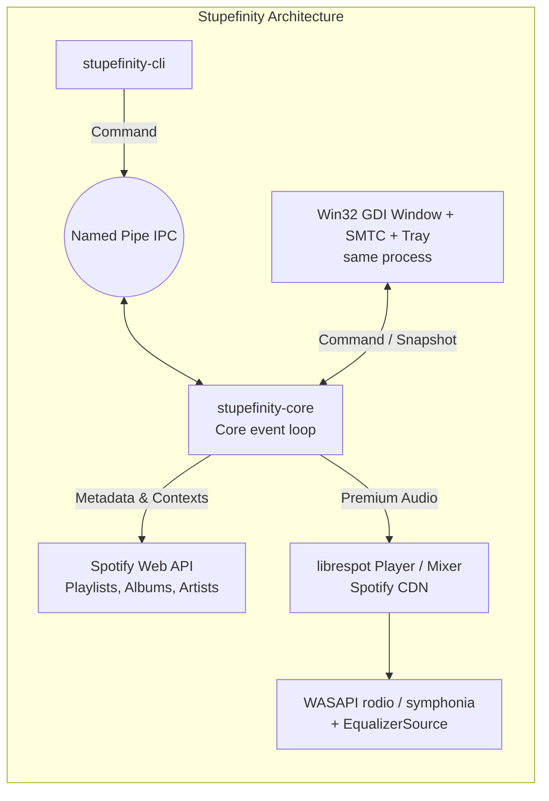

# Stupefinity

> **A native, ultra-lightweight Windows 11 music player for your Spotify account, engineered for extreme memory efficiency (≤ 10 MB Private Bytes / ~7.8 MB benchmarked).**

*Stupefinity is an independent project. It is not made, endorsed, sponsored or supported by Spotify. Spotify is a trademark of Spotify AB.*

## Key Goals

* **Strict Memory Budget**: Consistently under **10 MB Private Bytes** committed memory during active playback and idle (measured at **~7.8 MB Private Bytes**), compared to 500 MB, 1.5 GB for Electron/CEF-based music apps.
* **Zero Bundled Chromium**: No Electron, no WebView2, and no CEF runtime.
* **Spotify Premium playback** through `librespot`, with Spotify's Web API for your library, search, albums and artists.
* **Direct Form II AutoEq Equalizer**: Authentic acoustic DSP biquad filter profiles (Harman 2019, Vocal, HD650, Bass Boost, Treble Boost) inserted directly into the WASAPI playback pipeline.
* **Single Native Process**: One executable hosts the core engine, a double-buffered Win32 GDI window, system tray icon, and Windows SMTC media integration (`souvlaki`). Closing the window minimizes to tray while playback continues uninterrupted.
* **Windows 11 Native Integration**: Windows System Media Transport Controls (SMTC) overlay flyout, global media hotkeys, MMCSS audio thread scheduling, and EcoQoS power throttling.
* **Persisted Settings**: Local volume, shuffle, repeat, Smart Shuffle configuration, EQ profiles, and Discord Rich Presence stored across launches in `%LOCALAPPDATA%\Stupefinity\settings.json`.

---

## Benchmark Results

Measured on Windows 11 (`x86_64-pc-windows-gnu`, release build) across idle, UI, and active streaming states:

| Scenario / Metric | Measured Private Bytes | Target Budget | Status |
| :--- | :--- | :--- | :--- |
| **Whole app (`stupefinity.exe`, UI open, IPC running)** | **7.82 MB** | **≤ 10.0 MB** | **PASS** |
| Audio pipeline alone (test process, not the app) | 4.38 MB | - | lower bound only |

### How Memory is Measured

1. **Active Audio Streaming & DSP Benchmark** (`crates/stupefinity-core/tests/playback_memory_benchmark.rs`):
   Ignored by default because it needs an audio output device. It measures only the test process, so it is a lower bound for the audio pipeline, not the app's footprint. Simulates active network audio chunk delivery into `ProgressiveStreamReader`, decoding through Symphonia, processing through the Biquad Equalizer, and driving the WASAPI audio output sink while sampling Windows `K32GetProcessMemoryInfo` (`PagefileUsage`).
   ```bash
   cargo test --test playback_memory_benchmark -- --ignored --nocapture
   ```
2. **Resident App Process Benchmark** (`scripts/benchmark_memory.ps1`):
   Samples real-time Windows process performance counters (`PrivateMemorySize64` / `WorkingSet64`) on the running `stupefinity.exe` instance.
   ```powershell
   powershell -ExecutionPolicy Bypass -File scripts\benchmark_memory.ps1 -Launch -DurationSeconds 10
   ```

---

## Architecture



### Workspace Crates

| Crate | Path | Description |
| :--- | :--- | :--- |
| **`stupefinity-protocol`** | [`crates/stupefinity-protocol`](crates/stupefinity-protocol) | Shared IPC structs and enums (`Command`, `Snapshot`, `TrackInfo`, `QueueItem`, `PlaybackState`, `EqProfile`, `LyricsData`). |
| **`stupefinity-core`** | [`crates/stupefinity-core`](crates/stupefinity-core) | The application: OAuth PKCE, queue management, librespot playback, AutoEq DSP, Win32 double-buffered GDI UI, SMTC controls, and Named Pipe IPC. Builds `stupefinity.exe`. |
| **`stupefinity-cli`** | [`crates/stupefinity-cli`](crates/stupefinity-cli) | Command-line client to control the daemon, inspect playback state, or query playlists/search. |

---

## Getting Started

### Prerequisites
* **Rust**: `rustc` and `cargo` (1.80+)
* **C Compiler**: WinLibs MinGW GCC or MSVC C++ Build Tools

### Building
```bash
cargo build --release
```

### Running Stupefinity
```bash
./target/release/stupefinity.exe
```
The first launch walks you through a one-time setup:

1. **Terms**: read and agree to the [Terms of Use](docs/legal/TERMS.md) and
   [Privacy Policy](docs/legal/PRIVACY.md).
2. **Your own Spotify app**: Stupefinity has no shared client ID, so each person uses their
   own (with its own rate limit). Create an app at
   [developer.spotify.com/dashboard](https://developer.spotify.com/dashboard) (Spotify may
   require the app owner to have Premium), add the redirect URI
   `http://127.0.0.1:8888/login`, tick **Web API**, then paste the app's Client ID into
   Stupefinity (Ctrl+V) and press Enter. "Change client ID" on the login screen replaces it.
3. **Log In**: authorize in your browser (OAuth PKCE). Tokens are saved in
   `%LOCALAPPDATA%\Stupefinity\cache\token.json` and refreshed automatically. Playback needs
   Spotify Premium. **Log Out** deletes the token and the Spotify data Stupefinity holds.

If Spotify answers "429 Too Many Requests", Stupefinity waits out limits of up to 90 s on its
own and otherwise says how long to wait. (Untested so far: whether a Premium librespot session
accepts tokens from a personal client ID.)

The release build opens no console window; its log is written to
`%LOCALAPPDATA%\Stupefinity\stupefinity.log` (replaced on each launch). Debug builds keep a
console window but log to the same file. Data saved by earlier builds under
`%LOCALAPPDATA%\Stupefy` is moved to the new folder on first launch.

### Controlling via CLI
In another terminal:
```bash
# Print current playback snapshot
./target/release/stupefinity-cli.exe status

# Start playback or resume
./target/release/stupefinity-cli.exe play

# Pause playback
./target/release/stupefinity-cli.exe pause

# Toggle play/pause
./target/release/stupefinity-cli.exe toggle

# Play any Spotify track, playlist, album, or artist
./target/release/stupefinity-cli.exe play-uri spotify:track:4cOdK2wGLETKBW3PvgPWqT
./target/release/stupefinity-cli.exe play-uri spotify:playlist:37i9dQZF1DXcBWIGoYBM5M 0
./target/release/stupefinity-cli.exe play-uri spotify:album:4aawyAB9vmqN3uQ7FjRGTy
./target/release/stupefinity-cli.exe play-uri spotify:artist:06HL4z0CvFAxyc27GXpf02

# Skip or previous
./target/release/stupefinity-cli.exe next
./target/release/stupefinity-cli.exe prev

# Set volume (0 - 65535)
./target/release/stupefinity-cli.exe volume 45000

# Like / Unlike current track
./target/release/stupefinity-cli.exe like spotify:track:4cOdK2wGLETKBW3PvgPWqT

# Gracefully shutdown daemon
./target/release/stupefinity-cli.exe stop
```

---

## 🎛️ Keyboard Shortcuts

| Shortcut | Action |
| :--- | :--- |
| **Space** | Toggle Play / Pause |
| **Ctrl + Right / Left** | Next Track / Previous Track |
| **Right / Left Arrow** | Seek forward / backward 5 seconds |
| **Up / Down Arrow** | Adjust volume (±5%) |
| **Ctrl + F** | Switch to Search tab |
| **1-5** | Switch to Player, Search, Library, Lyrics, Equalizer tabs |
| **S** | Toggle Shuffle |
| **R** | Cycle Repeat mode (Off ➔ Context ➔ Track) |
| **L** | Switch to Synced Lyrics tab |
| **Escape** | Minimize to Windows System Tray |


## Documentation
* [**Terms of Use**](docs/legal/TERMS.md) and [**Privacy Policy**](docs/legal/PRIVACY.md) (drafts; shown in the app before first login).
* [**Implementation Plan**](docs/progress/roadmap.md): Tracks phase milestones and deliverables.
